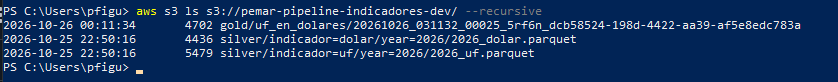
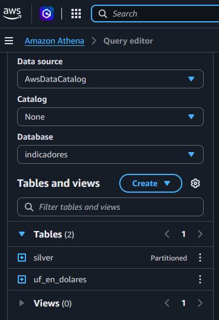
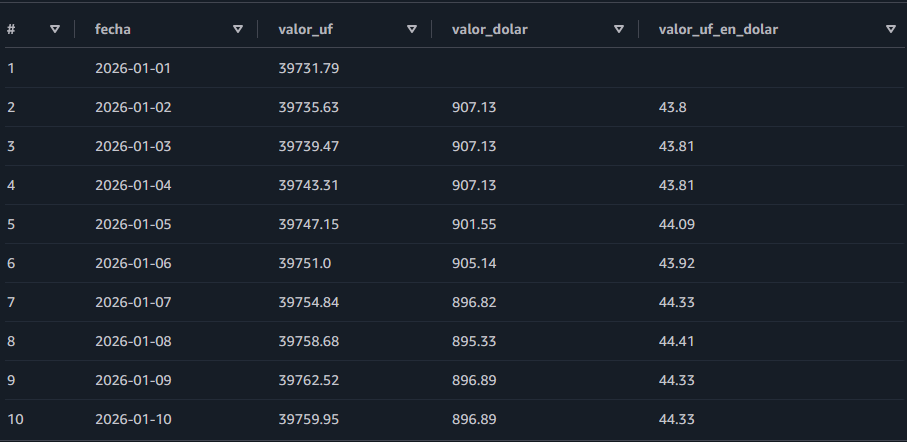

# pipeline-indicadores-chile

Pipeline de datos que extrae indicadores económicos de Chile desde una API pública, los organiza en una arquitectura medallion (bronze, silver y gold) y construye una tabla final con SQL y dbt, con pruebas de calidad.

El proyecto aplica conceptos de ETL que he usado durante años en DataStage y PowerCenter (staging, integración, marts, cuadraturas y reglas de negocio) con herramientas actuales: Python, Parquet, DuckDB y dbt.

## Arquitectura

```
API mindicador.cl
      │  Python (requests)
      ▼
BRONZE   JSON crudo, tal como llega de la API
      │  Python (pandas)
      ▼
SILVER   Parquet limpio y tipado, un archivo por indicador y año
      │  dbt + DuckDB (SQL)
      ▼
GOLD     Tabla uf_en_dolares en DuckDB, con pruebas de calidad
```

Los datos se guardan con **particionamiento estilo Hive** (`indicador=uf/year=2026/`), el formato que reconocen DuckDB, Athena y Glue.

## Estructura

```
pipeline-indicadores-chile/
├── src/
│   ├── extraer.py        # API -> bronze (JSON)
│   ├── transformar.py    # bronze -> silver (Parquet)
│   ├── consultar.py      # consultas exploratorias con DuckDB sobre silver
│   └── gold.py           # primera versión de gold en Python + DuckDB (reemplazada por dbt)
├── transformaciones/     # proyecto dbt
│   └── models/
│       ├── staging/
│       │   ├── sources.yml    # declara los Parquet de silver como fuentes
│       │   ├── stg_uf.sql
│       │   └── stg_dolar.sql
│       └── mart/
│           ├── uf_en_dolares.sql
│           └── schema.yml     # pruebas de calidad
└── data/                 # no se versiona (.gitignore)
    ├── bronze/
    ├── silver/
    └── gold/indicadores.duckdb
```

## Reglas de negocio

- **UF**: tiene valor todos los días y se publica por adelantado, hasta el día 9 del mes siguiente.
- **Dólar observado**: solo se publica en días hábiles, el día hábil anterior al que rige.
- **Fechas**: la API las entrega en UTC (`2026-11-09T03:00:00.000Z`). En silver se convierten a hora de Chile antes de quedarse con la fecha, para no correr los días.
- **Forward fill**: los días sin dólar (fines de semana y feriados) toman el último valor disponible. Se implementa con `ASOF LEFT JOIN` en DuckDB.
- **Caso conocido**: el 1 de enero no tiene un dólar anterior dentro de los datos del año, por lo que queda en nulo. La prueba `not_null` de `valor_dolar` está configurada como advertencia (`severity: warn`).

## Pruebas de calidad (dbt)

| Columna | Prueba | Severidad |
|---|---|---|
| `fecha` | `not_null`, `unique` | error |
| `valor_uf` | `not_null` | error |
| `valor_dolar` | `not_null` | advertencia |

## Cómo ejecutarlo

Requiere Python 3.12.

```powershell
git clone https://github.com/pemarfigueroa/pipeline-indicadores-chile.git
cd pipeline-indicadores-chile
python -m venv .venv
.venv\Scripts\Activate.ps1
pip install requests pandas pyarrow duckdb dbt-duckdb
```

**1. Extracción y transformación.** El indicador y el año se definen en las variables `indicador` y `year` al inicio de cada script. Ejecutar para `uf` y para `dolar`:

```powershell
cd src
python extraer.py
python transformar.py
```

**2. Configurar dbt.** Crear `C:\Users\<usuario>\.dbt\profiles.yml`:

```yaml
transformaciones:
  outputs:
    dev:
      type: duckdb
      path: C:/ruta/al/proyecto/data/gold/indicadores.duckdb
      threads: 1
  target: dev
```

**3. Construir gold y probar.**

```powershell
cd transformaciones
dbt debug
dbt run
dbt test
```

## Consideraciones

- La API de mindicador.cl es un servicio gratuito que puede cortar conexiones ante llamadas repetidas. La extracción se ejecuta una vez y el resto del pipeline trabaja sobre los archivos de bronze, sin volver a consultar la API.
- La ruta a silver en `sources.yml` se lee desde la variable de entorno `RUTA_DATOS` (por defecto `../data`), para poder apuntar a otro almacenamiento sin modificar el código.

## Próximos pasos

- **Parámetros desde fuera**: pasar indicador y año al ejecutar (`argparse`), sin editar los scripts.
- **Carga incremental e idempotente**: traer solo los datos nuevos y permitir reejecutar sin duplicar.
- **Columnas de auditoría**: fecha de carga e identificador de ejecución.
- **Dólar del año anterior**: completar el 1 de enero con el último valor de diciembre.
- **Orquestación**: ejecución automática diaria con GitHub Actions.
- **AWS**: almacenamiento en S3, consultas con Athena y tablas Iceberg.

# ETAPA AWS

Se agrega una etapa básica en AWS, en la cual los archivos Silver se suben a un bucket S3, las definiciones se almacenan en Glue Data Catalog, y la etapa Gold se genera con Athena.

## Subir archivos a Bucket S3
`aws s3 cp data/silver s3://pemar-pipeline-indicadores-dev/silver --recursive`

## AWS Athena

- Archivo: `01_crear_tablas.sql`, que crea la base de datos y tablas que se almacenan en Glue Data Catalog.
  - Se crea la base de Datos.
  - Se crea la Tabla en base a los archivos en S3.
  - Luego se usa `MSCK REPAIR` para poder registrar en el catálogo las particiones que existen en S3.
- Archivo `02_gold_uf_en_dolares.sql`.
  - Finalmente se crea la tabla Gold, a partir del Select del calculo de Uf en Dólares

Se adjuntan imagenes para validación:

Se muestra el resultado de los archivos en el Bucket de S3:\


Las tablas Silver y Gold en Athena:\


Resultado de datos en Gold:\


## Autor

Pedro Figueroa: desarrollador ETL con más de 20 años de experiencia en DataStage, PowerCenter, Oracle y SQL Server.
